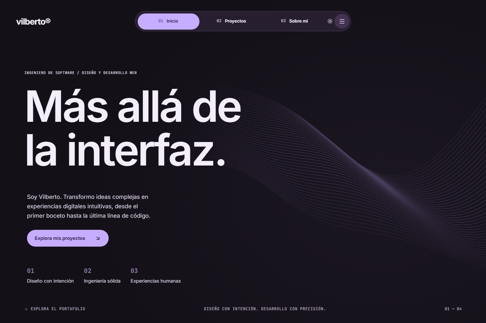

# Vilberto — Portafolio web

**Diseño con intención. Desarrollo con precisión.**

Mi espacio personal para presentar proyectos, compartir mi enfoque de diseño y desarrollo, y conectar con nuevas oportunidades. Una experiencia que une diseño de producto e ingeniería de software, desde el primer boceto hasta la última línea de código.

[Explorar el código](apps/frontend) · [LinkedIn](https://www.linkedin.com/in/vilberto-patricio-julca) · [Contacto](mailto:hello@vilberto.dev)

## Vista previa

## Diseño y experiencia

- **Identidad visual propia.** Una paleta violeta y una composición tipográfica que combina Inter, Instrument Serif y JetBrains Mono.
- **Dos formas de explorar.** Temas claro y oscuro, con la preferencia guardada entre visitas.
- **Interacción con intención.** Un campo visual con WebGL, transiciones de tema y animaciones de entrada que respetan la preferencia de movimiento reducido.
- **De móvil a escritorio.** Una interfaz adaptable que conecta la presentación, los proyectos destacados, mi perfil y el contacto.

## Tecnologías

- Next.js 16
- React 19
- TypeScript
- Tailwind CSS 4
- Lucide Icons

## Explorar el código

La aplicación está en [`apps/frontend`](apps/frontend). Su [README técnico](apps/frontend/README.md) explica cómo ejecutarla y actualizar el contenido.

Los textos, proyectos y habilidades se centralizan en [`portfolio.ts`](apps/frontend/src/data/portfolio.ts). Las secciones de la interfaz viven en [`src/components/sections`](apps/frontend/src/components/sections).

## Autor y licencia

Creado por **Vilberto Patricio Julca**, ingeniero de software con enfoque en diseño y desarrollo web.

[GitHub](https://github.com/Vilberto02/) · [LinkedIn](https://www.linkedin.com/in/vilberto-patricio-julca) · [hello@vilberto.dev](mailto:hello@vilberto.dev)

Publicado bajo la [licencia MIT](LICENSE).
